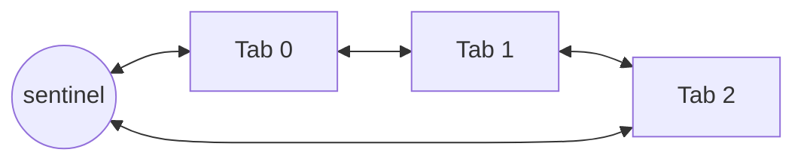
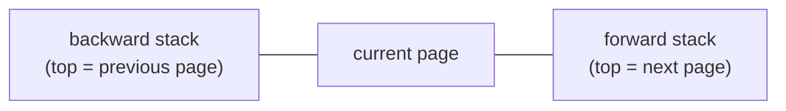

# Browser Tabs Simulator

A command-line browser simulation written in C. It manages multiple tabs, and each tab keeps its own page history with back/forward navigation.

Tabs are stored in a **circular doubly linked list with a sentinel node**, and every tab keeps its history in **two stacks** (backward and forward).

## Features

| Command | Description |
|---|---|
| `NEW_TAB` | Opens a new tab on the default page (`https://acs.pub.ro/`) and makes it the current tab |
| `CLOSE` | Closes the current tab; the previous tab becomes current. Tab `0` cannot be closed |
| `OPEN <id>` | Switches to the tab with the given id |
| `NEXT` / `PREV` | Moves to the next / previous tab (circular) |
| `PAGE <id>` | Navigates the current tab to a page from the page catalog and clears its forward history |
| `BACKWARD` / `FORWARD` | Moves back / forward in the current tab's history |
| `PRINT` | Prints the current tab id, the other tab ids in circular order, then the description of the current page |
| `PRINT_HISTORY <id>` | Prints the URLs in the history of a tab: from the furthest forward page, through the current page, down to the oldest page visited |

Invalid operations (closing tab `0`, opening a missing tab, an unknown page, empty history) print `403 Forbidden`.

## How it works

The browser is a ring of tabs around a sentinel node:



Each tab holds the page it is showing plus two stacks that make navigation cheap:



- `PAGE` pushes the current page on the backward stack and discards the forward stack.
- `BACKWARD` moves the current page to the forward stack and pops the backward stack.
- `FORWARD` does the reverse.

| Operation | Complexity |
|---|---|
| `NEW_TAB`, `BACKWARD`, `FORWARD` | O(1) |
| `PAGE` | O(p + f), where p is the number of pages in the catalog and f the size of the forward history |
| `OPEN`, `CLOSE`, `NEXT`, `PREV`, `PRINT` | O(n), where n is the number of tabs |

## Build and run

```bash
make build
./browser input.txt output.txt
```

`make run` runs the browser on one of the bundled examples and prints the result. `make test` runs all examples and compares them with the expected output. `make clean` removes build files.

## Input format

```text
N                       number of pages in the catalog
id                      \
url                      } repeated N times
description             /
M                       number of commands
command                 repeated M times, one per line
```

Example (`examples/02-navigation/input.txt`):

```text
3
10
https://www.wikipedia.org/
Free encyclopedia
20
https://www.mozilla.org/
Mozilla Foundation
30
https://www.python.org/
Python homepage
9
PAGE 10
PAGE 20
PAGE 30
PRINT_HISTORY 0
BACKWARD
PRINT
BACKWARD
FORWARD
PRINT
```

Output:

```text
https://www.python.org/
https://www.mozilla.org/
https://www.wikipedia.org/
https://acs.pub.ro/
0
Mozilla Foundation
0
Mozilla Foundation
```

## Project structure

```text
browser-tabs-simulator/
├── include/
│   └── functions.h      data structures and function declarations
├── src/
│   ├── main.c           input parsing and command dispatch
│   └── operations.c     tab, page and history operations
├── examples/            sample inputs with expected outputs
├── Makefile
└── README.md
```

## Memory safety

The program frees all of its memory. It was checked with AddressSanitizer and Valgrind on a suite of test inputs, with no leaks or memory errors reported.

## Limitations

- Input files must use Unix line endings (LF).
- URLs are limited to 49 characters, and tab and page ids to 3 digits.

## Mentions
Developed during my studies at UPB.